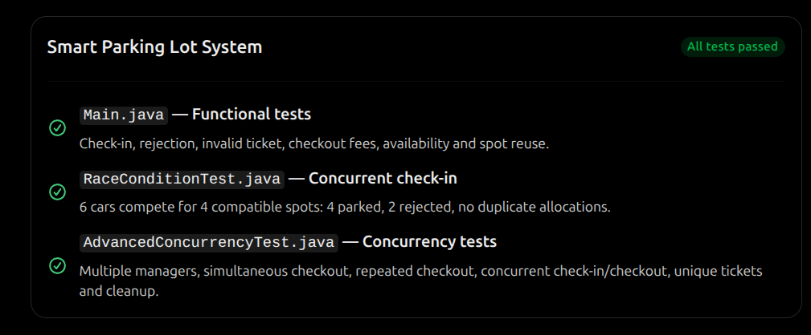

# Smart Parking Lot System

## Overview

The Smart Parking Lot System is a Low-Level Design (LLD) project that simulates a real-world parking lot management system. The system handles vehicle entry and exit, parking spot allocation, ticket generation, parking fee calculation, real-time availability updates, and concurrency handling.

This project demonstrates Object-Oriented Design principles and common design patterns used in scalable backend systems.

---

# Problem Statement

Design the low-level architecture for a backend system of a smart parking lot.

The system should:

- Manage vehicle entry and exit
- Allocate parking spots automatically
- Track parking duration
- Calculate parking fees
- Update parking spot availability in real time
- Handle concurrent vehicle check-ins and check-outs

---

# Functional Requirements

## Parking Spot Allocation

- Automatically assign a parking spot based on vehicle type and availability.

### Allocation Rules

| Vehicle Type | Allowed Parking Spot |
|-------------|---------------------|
| Bike | Small, Medium, Large |
| Car | Medium, Large |
| Bus | Large |

---

## Vehicle Check-In

When a vehicle enters:

- Find a suitable parking spot
- Mark the spot as occupied
- Generate a parking ticket
- Record entry time

---

## Vehicle Check-Out

When a vehicle exits:

- Retrieve parking ticket
- Record exit time
- Calculate parking fee
- Release parking spot
- Update availability

---

## Real-Time Availability

The system updates available parking spots whenever a vehicle enters or exits.

---

# Design Patterns Used

## 1. Singleton Pattern

**Class: ParkingLot**

Ensures only one parking lot instance exists throughout the application.

```java
ParkingLot parkingLot = ParkingLot.getInstance();
```

---

## 2. Strategy Pattern

**Used for Fee Calculation**

Different vehicle types can have different parking rates.

```java
FeeStrategy
```

Implementations:

```java
BikeFeeStrategy
CarFeeStrategy
BusFeeStrategy
```

Benefits:

- Open for extension
- Easy to support dynamic pricing
- Cleaner business logic

---

# UML Class Diagram

The UML diagram contains:

- ParkingLot
- ParkingFloor
- ParkingSpot
- Vehicle
- Bike
- Car
- Bus
- ParkingTicket
- Payment
- ParkingManager
- FeeStrategy

*(Attach UML Diagram Screenshot Here)*

---

# Database Design

## Vehicle

| Column | Type |
|----------|----------|
| vehicle_number | VARCHAR |
| vehicle_type | VARCHAR |

---

## Parking Floor

| Column | Type |
|----------|----------|
| floor_number | INT |

---

## Parking Spot

| Column | Type |
|----------|----------|
| spot_id | INT |
| floor_number | INT |
| spot_type | VARCHAR |
| occupied | BOOLEAN |

---

## Parking Ticket

| Column | Type |
|----------|----------|
| ticket_id | VARCHAR |
| vehicle_number | VARCHAR |
| spot_id | INT |
| entry_time | TIMESTAMP |
| exit_time | TIMESTAMP |

---

## Payment

| Column | Type |
|----------|----------|
| payment_id | VARCHAR |
| ticket_id | VARCHAR |
| amount | DECIMAL |
| status | VARCHAR |
| payment_time | TIMESTAMP |

---

# Entity Relationship Diagram

Entities:

- Vehicle
- ParkingFloor
- ParkingSpot
- ParkingTicket
- Payment

Relationships:

- One floor contains many spots
- One vehicle can have many tickets
- One parking ticket maps to one payment
- One ticket is associated with one spot

*(Attach ER Diagram Screenshot Here)*

---

# Spot Allocation Algorithm

## Bike

Priority:

```text
Small -> Medium -> Large
```

---

## Car

Priority:

```text
Medium -> Large
```

---

## Bus

Priority:

```text
Large
```

---

## Algorithm

```java
For each floor
    For each parking spot

        If spot is available
        And spot supports vehicle

            Allocate spot
            Mark occupied
            Return spot
```

Time Complexity:

```text
O(Number of Parking Spots)
```

---

# Fee Calculation Logic

The parking fee depends on:

- Vehicle Type
- Parking Duration

## Fee Structure

| Vehicle | Rate Per Hour |
|----------|----------|
| Bike | Rs. 20 |
| Car | Rs. 50 |
| Bus | Rs. 100 |

---

## Example

```text
Vehicle : Car

Duration : 4 Hours

Rate : Rs. 50/hour

Fee = 4 × 50

Total = Rs. 200
```

---
## Concurrency Handling

The parking lot system supports concurrent vehicle check-in and check-out operations.

To prevent race conditions during parking spot allocation, the critical methods are synchronized:

```java
public synchronized ParkingTicket checkIn(...)
public synchronized double checkOut(...)
```

### Concurrency Test

A multithreaded test was executed where four vehicles attempted to acquire parking spots simultaneously.

Output:

```text
CAR-1 got Spot 2
CAR-4 got Spot 3
CAR-2 got Spot 5
CAR-3 got Spot 4
```

### Observation

- No two vehicles received the same parking spot.
- Spot allocation remained consistent under concurrent access.
- The system remained thread-safe.
- Race conditions were successfully prevented.

----

# Real-Time Availability Update

The system updates parking spot availability immediately after:

- Vehicle Check-In
- Vehicle Check-Out

Example:

```text
Initial Available Spots : 3

After Bike Entry : 2

After Car Entry : 1

After Bus Entry : 0

After Checkout : 3
```

---

# Sequence Diagram

## Check-In Flow

```text
Vehicle
   |
ParkingManager
   |
ParkingLot
   |
ParkingSpot
   |
ParkingTicket
```

Process:

1. Vehicle enters
2. Spot allocated
3. Ticket generated
4. Entry time recorded

---

## Check-Out Flow

```text
Vehicle
   |
ParkingManager
   |
ParkingTicket
   |
FeeStrategy
   |
ParkingSpot
```

Process:

1. Vehicle exits
2. Parking duration calculated
3. Fee calculated
4. Spot released

---

# Sample Output

```text
===== INITIAL STATUS =====
Available Spots : 3

Bike Details
Vehicle Number : UP16BK1234
Ticket ID : 1a2b16fa
Spot ID : 1

Available Spots : 2

Car Details
Vehicle Number : UP16CR5678
Ticket ID : 0d907a1f
Spot ID : 2

Available Spots : 1

Bus Details
Vehicle Number : UP16BS9999
Ticket ID : abc12345
Spot ID : 3

Available Spots : 0

No Parking Spot Available

===== CHECKOUT =====

Bike Fee : Rs. 20.0
Car Fee : Rs. 50.0
Bus Fee : Rs. 100.0

===== AFTER CHECKOUT =====

Available Spots : 3
```

---

# Project Structure

```text
src
│
├── Main.java
│
├── enums
│   ├── VehicleType.java
│   ├── SpotType.java
│   └── PaymentStatus.java
│
├── model
│   ├── Vehicle.java
│   ├── Bike.java
│   ├── Car.java
│   ├── Bus.java
│   ├── ParkingSpot.java
│   ├── ParkingFloor.java
│   ├── ParkingLot.java
│   ├── ParkingTicket.java
│   └── Payment.java
│
├── service
│   └── ParkingManager.java
│
└── strategy
    ├── FeeStrategy.java
    ├── BikeFeeStrategy.java
    ├── CarFeeStrategy.java
    └── BusFeeStrategy.java
```


---

# Compile and Run
---
```
        javac -d out $(find src -name "*.java") && java -cp out Main
```

## RaceCondition ?
```
    javac -d out $(find src -name "*.java") && java -cp out RaceConditionTest
```
## Advance Concurrency ?
```
    javac -d out $(find src -name "*.java") && java -cp out AdvanceConcurrencyTest
```
---

## Overall Test Report



# Future Enhancements

- EV Charging Parking Spots
- Online Reservation System
- QR Code Based Entry and Exit
- Dynamic Pricing
- Mobile Application Integration
- Parking Analytics Dashboard
- Multiple Parking Lots Support
- Admin Portal

---

# Technologies Used

- Java
- Object-Oriented Programming
- Singleton Design Pattern
- Strategy Design Pattern
- UML
- PlantUML

---

# Author

**Vikash Kumar Kharwar**

Senior Software Engineer
